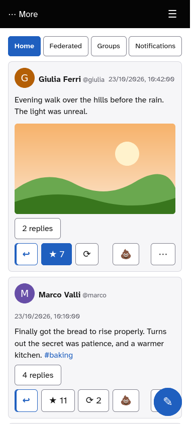
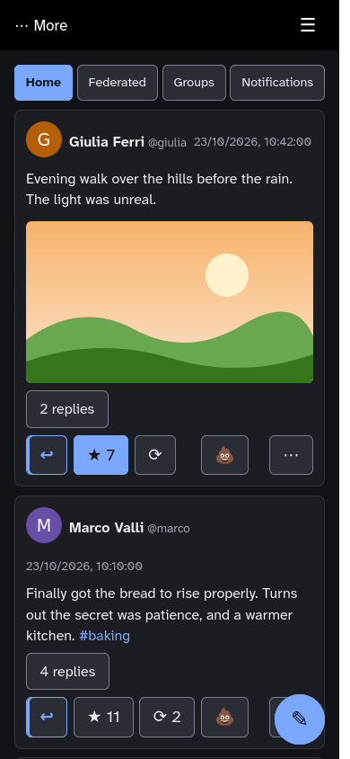
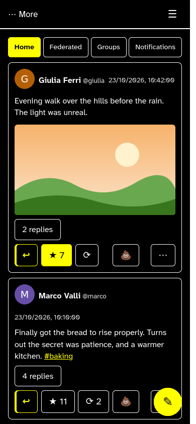

# Stabbyclient

A web client for [stabbypossum](https://git.keinpfusch.net/loweel/stabbypossum/), the ActivityPub server in Ada derived from snac2. It is a static installable app (PWA, aimed at Android Chrome), written
for the subset of the Mastodon API that stabbypossum really implements, and for the
extras stabbypossum has and ordinary Mastodon clients do not show: **dislike**, groups,
drafts and scheduled posts, "admirations".

It is not part of stabbypossum and needs nothing from it: only static files, served from the
same domain as the instance, under `/app/`.

<p align="center">



</p>

*The Home timeline on a phone in the light, dark and high-contrast themes. The people and posts in the pictures are invented.*

## What it does

- **Timelines**: Home, Federated and Groups, with a "N new posts" button in the header, a
  floating "back to top" button that appears after two screens of scrolling, a
  check for newer posts every minute while the app is open, and the last timeline shown at
  once on opening (cached on the device).
- **Posts**: like, **dislike**, boost, reply, quote (from the post's menu or with the Quote button of the reply form, as in stabbypossum's own); the post's hidden menu: emoji reaction, save,
  hide, pin, edit, delete, report, who liked it and who boosted it. Threads open in place (the replies below, the earlier
  posts above); polls can be voted on; pictures open full size; custom emoji are shown. A YouTube link in a post gets a Play button in a plain box: nothing is loaded from YouTube until you press it, then the video plays in place (from youtube-nocookie.com).
- **Writing**: text format (Markdown, plain, HTML with a small editor for bold, italic and
  strike-through), content warning, visibility, group, language, draft or scheduled, images,
  video and audio (with a preview of each picture, pictures can be pasted into the text, and alt text can still be changed after a failed send), pictures from a web address, polls, an emoji panel; in a pop-up.
- **More** menu, as in stabbypossum's own: search, bookmarks, admirations, drafts, scheduled
  posts, pinned posts, following (and following someone by handle), followers, follow requests,
  followed hashtags, lists, muted and blocked accounts, direct messages, editing your name, bio and switches,, your webfinger aliases, and what the instance says about itself.
- **Profiles**: bio, fields, posts, who follows whom; follow, block, mute, direct message, and for someone on another instance a Flag link to stabbypossum's settings page (flags slow an account down; they are not API).
- **Notifications** with a read position kept on the server (two devices agree), one by one
  dismissal, and the instance's announcements.
- Light, dark, high-contrast (white on black, yellow links) or automatic theme, and a choice of font: Atkinson Hyperlegible (proportional,
  the default), Atkinson Hyperlegible Mono, the one stabbypossum's interface uses, or OpenDyslexic (SIL Open Font
  Licence for the Atkinson fonts, CC BY 3.0 for OpenDyslexic, texts in `app/fonts/`); English and Italian (one catalogue per language in
  `app/js/locales/`; adding a language is adding a catalogue and listing it in `app/js/app.js`).
- A line in the settings menu (☰) with the version and the last check of each timeline, to
  tell at a glance what a device is running.

Not there yet: the RSS/Atom feeds page and stabbypossum's other Settings pages (avatar, header and profile fields,
advanced, people, instance setup), which are server pages and not API.

## Accessibility

Stabbyclient is built to meet the WCAG 2.1 level AA guidelines. It was checked by reading the code and
by trying it in a browser; it has not yet been tested with a screen reader, so tell us if something
gets in your way.

- **Keyboard**: everything can be done without a mouse. In a pop-up (writing a post, a picture shown
  full size) the Tab key stays inside it, Escape closes it and you land back where you were.
- **Screen readers**: the page title and the main heading say which view you are in, posts are read
  in their own language, and short messages are announced as they appear.
- **Colours**: text, buttons and the edges of fields have enough contrast in every theme, and
  nothing relies on colour alone.
- **Touch**: buttons and links are large enough to tap.
- **Buttons by kind**: the main action of a screen is filled (Send, Follow), the others have an outline, reply and quote are marked in the accent colour, and only Delete and Block are red (dashed in the high-contrast theme), always with a text label.

What you can choose, from the settings menu (☰):

- **Theme**: automatic (follows your device), light, dark, or **high contrast** (white on black, yellow
  links and focus marks, white edges) for low vision.
- **Font**: Atkinson Hyperlegible (made for legibility, the default), its monospace version, or
  **OpenDyslexic**.
- **Language**: automatic, English or Italian.
- Text follows your browser's text size and zoom.

## Installing it on an instance

The app must be served **under `/app/` of the instance's own domain**: the API and login are
called with paths from the root of that domain and the login comes back to
`https://<domain>/app/`. See [`deploy/README.md`](deploy/README.md) for the details. In short:

1. Install `app/` on the host: `tools/deploy.sh root@HOST`. It stamps the commit as the version shown
   in the menu and runs `tools/remote-install.sh` there, which swaps the whole `app/` tree in (a
   removed file disappears from the host, the previous version stays in `app.prev`) with root-owned,
   read-only files. The web root on the host is still `/var/www/xenoclient`, the name from before the rename (edit it in `tools/deploy.sh`).
2. Add the two `location` blocks of [`deploy/nginx-app.conf`](deploy/nginx-app.conf) to the
   instance's HTTPS `server { }`, before `location / {`, adjusting the `alias` path, then
   `nginx -t` and reload. They set `Cache-Control: no-cache` (otherwise browsers keep old
   scripts for hours), a strict Content-Security-Policy for `/app/` only, and HSTS (nginx drops the server block's headers inside a location that has its own, so repeat there any other header the server sets).
3. Open `https://<domain>/app/`, log in, then use the browser's "Install app".

An instance user called `app` would be hidden by `/app/`. The server must be stabbypossum: the
groups, drafts, admirations and dislike routes do not exist elsewhere.

Updating is repeating step 1; devices pick the new version on their next online open.

## Development

No build step and no runtime dependencies: plain ES modules. A recent Node (with the built-in test runner, `node:test`) is enough.

```sh
npm install        # linkedom, for the tests
npm test           # unit tests (node --test)
```

- `tools/dev-proxy.mjs https://<instance> 8099` serves `app/` at `http://localhost:8099/app/`
  and forwards everything else to the instance, as nginx would. It sends the same
  Content-Security-Policy as `deploy/nginx-app.conf`.
- `tools/e2e-smoke.mjs <user>` drives the app in headless Chromium against a real
  instance (`STABBY_TEST_PW` for the password; `STABBY_BASE=https://<instance>` to test the
  deployed copy instead of the proxy). Use a **test account**: the run writes and deletes posts.
- `tools/deploy.sh root@HOST` publishes, as above.

Layout: `app/index.html`, `app/js/*.js` (one module per concern: `api.js`, `auth.js`,
`timeline.js`, `status-card.js`, `composer.js`, `more.js`, `profile.js`, …), `app/css/app.css`,
`app/sw.js` (service worker), `app/manifest.webmanifest`, `tests/`, `deploy/`, `tools/`.
Design and plan are in `docs/superpowers/`.

## Things about stabbypossum worth knowing

Measured against a real instance; the client works around them where it can.

- Lists (Home, a profile's posts) lag a few seconds behind a new post, keep a post's reply
  and boost counts as they were when it arrived, and keep deleted posts. The client re-reads
  the first ten posts on screen from the post itself to correct this.
- Older stabbypossum versions answered 500 to `DELETE /api/v1/statuses/:id` for a post that has
  replies or that its author has liked (fixed upstream on 17/10/2026); the client says so
  when a delete is refused.
- `dislikes_count` is always 0 (only "did I dislike it" is known); there is no push and no
  streaming, so notifications come from polling while the app is open.
- Some routes (drafts, scheduled posts, admirations, hide, remote picture addresses)
  answer only to requests carrying the `X-Instance-UI: 1` header; the client sends it on
  exactly those.

## Security notes

The login token is kept in the browser's `localStorage`. Mitigations: all post HTML is
rebuilt through an allow-list sanitizer, addresses used for pictures and links must be
`http(s)`, there are no third-party scripts, and `/app/` has its own strict
Content-Security-Policy. Logging out removes the account's cached timelines and drafts from the device.

## Licence

[European Union Public Licence v. 1.2](LICENSE) (EUPL-1.2), the same as stabbypossum. The Atkinson font files
in `app/fonts/` are under the SIL Open Font Licence 1.1, OpenDyslexic under CC BY 3.0 (the texts sit beside them).
